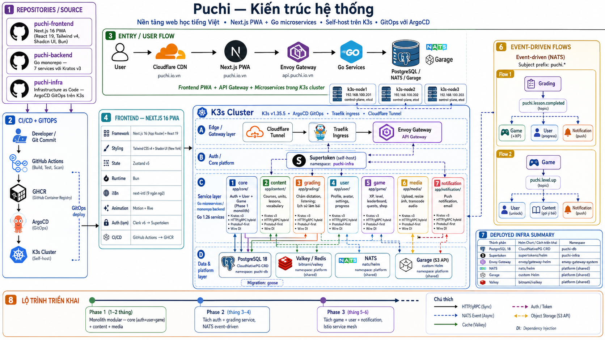

# Puchi

**Puchi** — nền tảng web học tiếng Việt.

Kiến trúc: **Next.js PWA (frontend) + Go microservices (backend)**, self-host trên K3s cluster, GitOps với ArgoCD.

---

## Repositories

| Repo | Mô tả |
|------|-------|
| [puchi-frontend](https://github.com/puchidemy/puchi-frontend) | Next.js 16 PWA (React 19, Tailwind v4, Shadcn UI, Bun) |
| [puchi-backend](https://github.com/puchidemy/puchi-backend) | Go monorepo — 8 services với Kratos v3 |
| [puchi-infra](https://github.com/puchidemy/puchi-infra) | Infrastructure as Code — ArgoCD GitOps trên K3s |

---

## Kiến trúc

```
User ──► Cloudflare CDN ──► Next.js PWA ──► Envoy Gateway ──► Go Services ──► PostgreSQL / NATS / Garage
(puchi.io.vn)                                  (api.puchi.io.vn)   (Kratos v3)    (K3s cluster)
```

### Frontend

| Thành phần | Công nghệ |
|------------|-----------|
| Framework | Next.js 16 (App Router) + React 19 |
| Styling | Tailwind CSS v4 + Shadcn UI (New York) |
| State | Zustand v5 |
| Runtime | Bun (install) + Node.js (build) |
| i18n | next-intl (9 ngôn ngữ) |
| Animation | Motion + Rive |
| Auth | Custom AuthProvider — gọi trực tiếp auth-service |
| CI/CD | GitHub Actions → GHCR |

### Backend

| Thành phần | Công nghệ |
|------------|-----------|
| Ngôn ngữ | Go 1.26 |
| Framework | Kratos v3 (HTTP/gRPC hybrid, Protobuf-first, Wire DI) |
| Auth | Auth-service tự xây dựng (JWT RS256 + opaque refresh token) |
| API Gateway | Envoy Gateway (CORS-only, JWT passthrough) |
| Database | PostgreSQL 18 (CloudNativePG) |
| Cache | Valkey (cache + rate limit + token blacklist) |
| Message Queue | NATS (event-driven) |
| Object Storage | Garage (S3 API, self-host) |
| Migration | goose |

### Cluster

| Node | IP | Role |
|------|-----|------|
| k3s-node1 | 192.168.100.201 | control-plane, etcd |
| k3s-node2 | 192.168.100.202 | control-plane, etcd |
| k3s-node3 | 192.168.100.203 | control-plane, etcd |

K3s v1.35.5, ArgoCD GitOps, Traefik ingress, Cloudflare Tunnel.

---

## Authentication (Self-hosted Auth Service)

Auth tự xây dựng thay thế hoàn toàn Zitadel/Supertokens.

```
Browser ──► puchi.io.vn (Next.js)
 │
 ├─► /api/auth/* → api.puchi.io.vn/auth → auth-service:8080
 │   ├── POST /login          (email+password → Argon2id)
 │   ├── POST /register       (Argon2id → user)
 │   ├── POST /refresh        (rotate opaque token)
 │   ├── POST /logout         (revoke session)
 │   ├── GET  /social/google  (OAuth2 direct)
 │   ├── GET  /social/facebook
 │   ├── GET  /social/tiktok
 │   ├── POST /magic-link/send   (passwordless)
 │   ├── POST /mfa/totp/enroll   (TOTP authenticator app)
 │   ├── GET  /sessions          (device management)
 │   └── POST /admin/roles       (RBAC)
 │
 ├─► api.puchi.io.vn/{core,user,...} → Go services
 │   └── JWT verify via pkg/auth/ (JWKS local, 15min cache)
 │
 └── Double token: JWT access (RS256, 15min) + opaque refresh (SHA-256, 30d rotation)
```

Auth methods: Email/Password + Google + Facebook + TikTok + Magic Link + TOTP MFA.

---

## 8 Services

| Service | Module | Trách nhiệm |
|---------|--------|-------------|
| **auth** | `app/auth/` | Identity: login, register, OAuth2, session, MFA, RBAC |
| **core** | `app/core/` | Auth + User + Game (Phase 1 monolith) |
| **content** | `app/content/` | Courses, units, lessons, vocabulary |
| **grading** | `app/grading/` | Chấm dictation, listening; lịch sử làm bài |
| **user** | `app/user/` | Profile, avatar, settings, progress |
| **game** | `app/game/` | XP, level, leaderboard, quests, shop |
| **media** | `app/media/` | Upload, resize ảnh, transcode audio |
| **notification** | `app/notification/` | Push notification, email |

---

## Deployed Infrastructure

| Service | Chart | Namespace |
|---------|-------|-----------|
| PostgreSQL 18 | CloudNativePG CRD | puchi-db |
| Auth Service | custom Helm | puchi-backend |
| Envoy Gateway | envoy/gateway-helm | envoy-gateway-system |
| NATS | nats/helm | platform (shared) |
| Garage | custom Helm | platform (shared) |
| Valkey | bitnami/valkey | platform (shared) |

---

## Event-driven (NATS)

```
Auth       ──► "auth.user.created"   ──► Core (sync profile)
Grading    ──► "lesson.completed"    ──► Game (+XP), User (progress), Notification (push)
Game       ──► "level.up"            ──► User (unlock), Content (gợi ý bài), Notification (push)
```

Subject prefix: `puchi.*`

---

## Lộ trình triển khai

| Phase | Thời gian | Mô tả |
|-------|-----------|-------|
| 0 | Đã hoàn thành | Auth service tự xây dựng (thay Zitadel/Supertokens) |
| 1 | 1-2 tháng | Monolith modular: core (auth+user+game) + content + media |
| 2 | tháng 3-4 | Tách grading service, NATS event-driven |
| 3 | tháng 5-6 | Tách game + user + notification, Istio service mesh |

---

## Tài liệu tham khảo

- [Kratos](https://go-kratos.dev/) — Go microservice framework
- [Envoy Gateway](https://gateway.envoyproxy.io/) — API Gateway
- [NATS](https://nats.io/) — Message broker
- [Garage](https://garagehq.deuxfleurs.fr/) — S3-compatible object storage
- [CloudNativePG](https://cloudnative-pg.io/) — PostgreSQL operator
